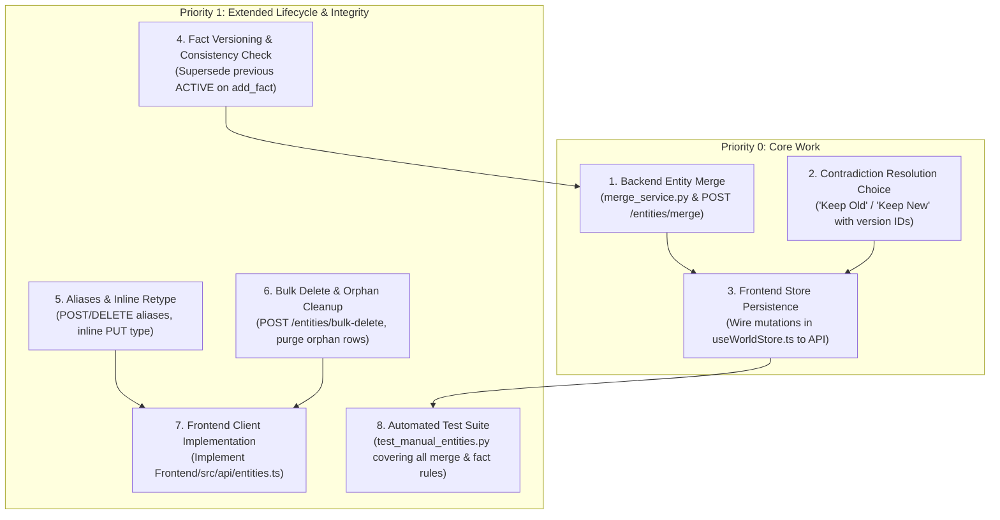

# Person A Implementation Plan: Manual Entities, Facts & Contradictions

**Role:** Person A  
**Git Branch:** `feature/manual-entities` (branched from `main` at tag `step0`)  
**Specification References:** [`backend/.ai/SPLIT.md`](file:///d:/Projects/Orion---World-State-Engine/backend/.ai/SPLIT.md), [`backend/.ai/RULES.md`](file:///d:/Projects/Orion---World-State-Engine/backend/.ai/RULES.md), [`docs/api.md`](file:///d:/Projects/Orion---World-State-Engine/docs/api.md) (§7, §10, §13), and [`Orion Task Split for Manual Features and Extraction.md`](file:///d:/Projects/Orion---World-State-Engine/Orion%20Task%20Split%20for%20Manual%20Features%20and%20Extraction.md)

---

## 1. Ownership & Boundary Constraints

### 1.1 Files Owned by Person A

| Layer | Files |
|---|---|
| **Routes** | [`backend/app/api/v1/routes/entities.py`](file:///d:/Projects/Orion---World-State-Engine/backend/app/api/v1/routes/entities.py), [`backend/app/api/v1/routes/contradictions.py`](file:///d:/Projects/Orion---World-State-Engine/backend/app/api/v1/routes/contradictions.py) |
| **Schemas** | [`backend/app/schemas/entity.py`](file:///d:/Projects/Orion---World-State-Engine/backend/app/schemas/entity.py) |
| **Services** | [`backend/app/services/entity_service.py`](file:///d:/Projects/Orion---World-State-Engine/backend/app/services/entity_service.py), [`backend/app/services/merge_service.py`](file:///d:/Projects/Orion---World-State-Engine/backend/app/services/merge_service.py) *(new)* |
| **Tests** | [`backend/app/tests/test_manual_entities.py`](file:///d:/Projects/Orion---World-State-Engine/backend/app/tests/test_manual_entities.py) *(new)* |
| **Frontend Store & Types** | [`Frontend/src/store/useWorldStore.ts`](file:///d:/Projects/Orion---World-State-Engine/Frontend/src/store/useWorldStore.ts), [`Frontend/src/data/mockData.ts`](file:///d:/Projects/Orion---World-State-Engine/Frontend/src/data/mockData.ts) |
| **Frontend Pages & Components** | [`Frontend/src/pages/EntityLedger.tsx`](file:///d:/Projects/Orion---World-State-Engine/Frontend/src/pages/EntityLedger.tsx), [`Frontend/src/components/EntityPanel.tsx`](file:///d:/Projects/Orion---World-State-Engine/Frontend/src/components/EntityPanel.tsx), [`Frontend/src/pages/Contradictions.tsx`](file:///d:/Projects/Orion---World-State-Engine/Frontend/src/pages/Contradictions.tsx) |
| **Frontend Client Stubs** | [`Frontend/src/api/entities.ts`](file:///d:/Projects/Orion---World-State-Engine/Frontend/src/api/entities.ts) |

### 1.2 Invariant Boundary Rules

1. **Rule S.1 (Frozen Schema):** Never modify [`backend/app/models/`](file:///d:/Projects/Orion---World-State-Engine/backend/app/models/) or add files to [`backend/alembic/versions/`](file:///d:/Projects/Orion---World-State-Engine/backend/alembic/versions/). The schema is frozen at tag `step0`.
2. **Rule 3.4 (Manual Carve-Out):**
   - Manual edits to facts or relationship types must **append a new version** (`FactVersion` with status `ACTIVE`) and mark the previous active version `SUPERSEDED`. Never perform in-place SQL updates on stored values.
   - Merging entities may repoint foreign keys and update version statuses (`ACTIVE` → `SUPERSEDED`), but never rewrites stored values.
   - Author-initiated deletes of entities, relationships, events, and facts are allowed, and must clean up any orphan contradictions.
3. **Repository Append-Only:** In [`backend/app/repositories/`](file:///d:/Projects/Orion---World-State-Engine/backend/app/repositories/), only add new methods. Never remove or alter existing signatures.
4. **Frozen Files (Hands Off):**
   - [`backend/app/api/v1/router.py`](file:///d:/Projects/Orion---World-State-Engine/backend/app/api/v1/router.py)
   - [`Frontend/src/App.tsx`](file:///d:/Projects/Orion---World-State-Engine/Frontend/src/App.tsx)
   - [`backend/app/tests/conftest.py`](file:///d:/Projects/Orion---World-State-Engine/backend/app/tests/conftest.py)
   - [`docs/api.md`](file:///d:/Projects/Orion---World-State-Engine/docs/api.md)
   - [`Frontend/src/api/stub.ts`](file:///d:/Projects/Orion---World-State-Engine/Frontend/src/api/stub.ts)
5. **No Interference with Other Roles:** Do not touch Extraction files (`world_state_service.py`, `pipeline/`, `workers/`, `chapters.py`, `WritingRoom.tsx`, `ProcessingWorld.tsx`) or Person B files (`relationships.py`, `events.py`, `graph.py`, `WorldGraph.tsx`, `WorldTimeline.tsx`).

---

## 2. Core Responsibilities & Tasks



---

## 3. First Thing to Do & How

### The First Task: Backend Contracts & Transactional Merge Engine

The first action is to implement the **Entity Merge Engine** ([`backend/app/services/merge_service.py`](file:///d:/Projects/Orion---World-State-Engine/backend/app/services/merge_service.py)), its Pydantic schemas in [`backend/app/schemas/entity.py`](file:///d:/Projects/Orion---World-State-Engine/backend/app/schemas/entity.py), the API route `POST /api/v1/worlds/{world_id}/entities/merge` in [`backend/app/api/v1/routes/entities.py`](file:///d:/Projects/Orion---World-State-Engine/backend/app/api/v1/routes/entities.py), and test coverage in [`backend/app/tests/test_manual_entities.py`](file:///d:/Projects/Orion---World-State-Engine/backend/app/tests/test_manual_entities.py).

### How It Will Be Executed

#### Step 1: Add Request Schemas to `schemas/entity.py`
Define `MergeEntitiesRequest`, `BulkDeleteEntitiesRequest`, and `AliasCreateRequest`:
```python
class MergeEntitiesRequest(BaseModel):
    source_id: str
    target_id: str

class BulkDeleteEntitiesRequest(BaseModel):
    entity_ids: List[str] = Field(..., min_length=1)

class AliasCreateRequest(BaseModel):
    alias: str = Field(..., min_length=1, max_length=255)

    @field_validator("alias")
    @classmethod
    def validate_alias(cls, v: str) -> str:
        s = v.strip()
        if not s:
            raise ValueError("alias cannot be empty.")
        return s
```

#### Step 2: Implement `merge_service.py`
Operate directly on the models within a single database transaction (`db.begin_nested()` or managed session):
1. **Precondition Checks:**
   - Verify `source_id != target_id` (raise `HTTPException(400)`).
   - Verify both `source` and `target` exist and belong to `world_id` (raise `HTTPException(404)`).
   - Check if any processing job for `world_id` is currently `queued` or `processing` (raise `HTTPException(400)`).
2. **Rule 1 (Aliases):**
   - Collect source canonical name and all source aliases.
   - Add them to target aliases, deduplicated case-insensitively, skipping any that match `target.canonical_name` (case-insensitively) or existing target aliases.
3. **Rule 2 (Mentions):**
   - Repoint all `EntityMention` (`entity_mentions.entity_id = target.id`) and `FactMention` (`fact_mentions.entity_id = target.id`) rows from source to target.
4. **Rule 3 (Facts & Versions):**
   - For each fact on `source`:
     - If `target` has a fact with identical `property_name`:
       - If both have an `ACTIVE` version with different values: target's stays `ACTIVE`, source's is marked `SUPERSEDED`.
       - Repoint all versions of the source fact to the target fact (`FactVersion.fact_id = target_fact.id`).
       - Delete the empty source fact.
     - If `target` does not have that `property_name`:
       - Repoint the fact itself (`Fact.entity_id = target.id`).
5. **Rule 4 (Event Participants):**
   - For each `EventParticipant` of `source`:
     - If `target` is already a participant in the same `event_id`: delete the source participant row (drop duplicate).
     - Otherwise: repoint `participant.entity_id = target.id`.
6. **Rule 5 (Relationships & Versions):**
   - Delete any relationship self-loops (`source -> target`, `target -> source`, `source -> source`).
   - For outgoing `source -> X` (where `X != target`):
     - If `target -> X` already exists: move all `RelationshipVersion` rows from `source -> X` to `target -> X`, then delete `source -> X`.
     - Otherwise: repoint `relationship.source_entity_id = target.id`.
   - For incoming `Y -> source` (where `Y != target`):
     - If `Y -> target` already exists: move all `RelationshipVersion` rows to `Y -> target`, then delete `Y -> source`.
     - Otherwise: repoint `relationship.target_entity_id = target.id`.
7. **Rule 6 (Delete Source & Orphan Contradictions):**
   - Delete the source entity.
   - Delete any contradictions referencing removed entities or orphaned fact/relationship versions.
   - Commit transaction and return target as `EntityResponse`.

---

## 4. Phased Implementation Roadmap

### Phase 1: Backend Entity Merge Engine
- **Files:** `schemas/entity.py`, `merge_service.py`, `routes/entities.py`, `test_manual_entities.py`
- **Deliverables:**
  - `MergeEntitiesRequest` schema
  - Complete `MergeService.merge_entities(world_id, source_id, target_id)` implementation
  - Route handler `POST /api/v1/worlds/{world_id}/entities/merge`
  - Unit tests verifying all 6 merge rules, self-loop pruning, duplicate event dropping, and fact version folding

### Phase 2: Fact Versioning Fix & Contradiction Choice Support
- **Files:** `entity_service.py`, `routes/entities.py`, `routes/contradictions.py`
- **Deliverables:**
  - In `EntityService.add_fact`: retire existing `ACTIVE` version to `SUPERSEDED` before adding the new active version.
  - Call `ConsistencyService.evaluate_fact_version` on manual fact addition. If a contradiction is detected, mark new version `CONTRADICTED`, retain old as `ACTIVE`, and record contradiction.
  - Orphan contradiction cleanup function when facts or entities are deleted.
  - Verify `POST /contradictions/{id}/resolve` handles `preferred_fact_version_id` and `preferred_relationship_version_id` correctly.

### Phase 3: Aliases, Inline Retype & Bulk Delete
- **Files:** `schemas/entity.py`, `routes/entities.py`, `entity_service.py`
- **Deliverables:**
  - `POST /worlds/{world_id}/entities/{entity_id}/aliases` (§13.3)
  - `DELETE /worlds/{world_id}/entities/{entity_id}/aliases?alias=...` (§13.4)
  - `POST /worlds/{world_id}/entities/bulk-delete` (§13.2)
  - Inline type updating via existing `PUT /worlds/{world_id}/entities/{entity_id}` (§13.5)

### Phase 4: Frontend API Layer & Store Persistence
- **Files:** `Frontend/src/api/entities.ts`, `Frontend/src/store/useWorldStore.ts`
- **Deliverables:**
  - Implement all functions in `entities.ts` (`createEntity`, `addFact`, `mergeEntities`, `bulkDeleteEntities`, `addAlias`, `removeAlias`) via `apiFetch`.
  - Wire `useWorldStore.ts` actions:
    - `updateEntity`: call `PUT /entities/{id}`
    - `deleteEntity`: call `DELETE /entities/{id}`
    - `addFact`: call `POST /entities/{id}/facts` with `{ property_name, value }`
    - `deleteFact`: call `DELETE /entities/{id}/facts/{factId}`
    - `mergeEntities`: call `mergeEntities` API and update store state
    - `resolveContradictionInBackend`: pass `preferredFactVersionId` / `preferredRelationshipVersionId`

### Phase 5: Frontend UI Enhancements
- **Files:** `EntityLedger.tsx`, `EntityPanel.tsx`, `Contradictions.tsx`
- **Deliverables:**
  - **EntityLedger:** Selection mode to pick two entities, select target/survivor, and trigger merge confirmation modal. Bulk selection for bulk-delete.
  - **EntityPanel:** Update the Add Fact form to supply both `Property Name` and `Value`. Add Alias addition and removal tags. Inline entity type selector.
  - **Contradictions:** Replace hardcoded mock choices with real "Keep Old" / "Keep New" buttons using `c.old_fact_version_id` and `c.new_fact_version_id`.

### Phase 6: Verification & Test Suite
- **Files:** `test_manual_entities.py`
- **Deliverables:**
  - Run full backend test suite (`pytest app/tests/ -q`) ensuring 0 failures.
  - Run frontend build & lint (`npm run build && npm run lint`).
  - Verify seed script (`python scripts/seed_demo_world.py`) works smoothly with merge and contradiction flows.
